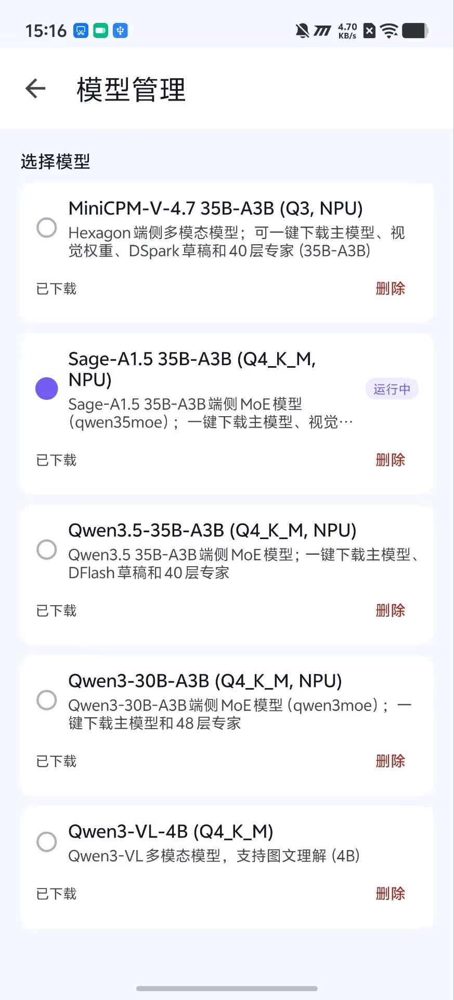

<div align="center">

<h1 align="center">
  
  MobiInfer · Android
</h1>


**在手机上本地运行 35B 级 MoE 大模型**

[](https://github.com/IPADS-SAI/Mobiinfer-Android/releases)
[](#)
[-blue)](#)
[](#)
[](LICENSE)

中文 | [English](README_EN.md)

</div>

---

## 最新动态

- [2026.10.22] 🔥 **Day-0 适配** InternScience 最新 **Sage-A1.5 35B-A3B**在手机上的运行，支持 41 层专家从 HTP tiled 包流式加载。
- [2026.10.19] 🛠️ 支持 Qwen3-30B-A3B / Qwen3.5-MoE-35B-A3B，MoE 专家可走外置槽位与 LES。
- [2026.10.17] 🚀 发布 **MobiInfer-Android v0.1**，支持模型管理、一键下载和端侧 NPU 推理。

---

## 介绍

> **一台骁龙手机，用 NPU 跑 35B-A3B 级 MoE 大模型**

MobiInfer-Android 引入完整的 **Qualcomm Hexagon NPU 后端**，打通了**端侧大 MoE 模型**的完整链路：专家权重常驻闪存、按需流式加载到 NPU、用前瞻调度掩盖 I/O 延迟，再叠加 **DSpark 投机采样**进一步提速。

仓库提供[Android 应用安装包](https://github.com/IPADS-SAI/Mobiinfer-Android/releases)和源码（`Android-App/`），安装后即可在手机上直接使用。

**支持的设备**


| 搭载芯片 | 手机型号 |
|--|--|
| 骁龙8 Elite | 一加13、红米K80 Pro、小米15 / 小米15 Ultra、真我GT7 Pro、iQOO 13、红魔11S Pro、荣耀Magic7系列、iQOO Neo10 Pro+ |
| 骁龙8 Gen5 | 一加Ace 6T、iQOO Z11 Turbo、vivo S50 Pro mini、Redmi K100 Pro、真我GT8、联想拯救者Y70、STEPX Neo 先行版 |
| 骁龙8 Elite Gen5 | 小米17系列（含Pro/Pro Max/Ultra）、一加15、真我GT8 Pro、红米K90 Pro Max、iQOO 15、荣耀Magic8系列、三星Galaxy S26系列、红魔游戏手机、vivo X300系列 |

<p align="center">
  
  
</p>

---

## 核心

- 🚀 **原生 Hexagon NPU 后端**
  HVX/HMX 张量核、Flash-Attention、Gated Delta Net、DMA 队列与多设备切分

- 🧠 **端侧大 MoE 专家卸载**
  专家权重外置闪存、按需流式加载进 HTP

- ⚡ **LES 前瞻专家调度**
  跨层预测下一层专家并提前预取，命中先算、未命中并行加载

- 🎯 **DSpark 投机采样**
  DFlash + 半自回归 Markov 头与置信度头，端侧适配，与专家调度协同

- 📦 **专家打包工具链**
  打包专家权重，输出 HTP tiled 布局。

- 💾 **权重存取优化**
  逐层混合精度量化 + 专家连续重排，减少闪存分散读。

---

## 支持的模型

| 模型 / Model | 规模 / Scale | 权重大小 | 说明 / Notes |
|---|---|---|---|
| **[MiniCPM-V 4.7 35B-A3B](https://www.modelscope.cn/models/fengerhu1/MiniCPM-V-4.7-35B-A3B-gguf-hexagon)** | 35B 总参 / 3B 激活 | ~19.3G | 端侧 MoE 主线目标，多模态（视觉 + 文本） |
| **[Qwen3.5-35B-A3B](https://www.modelscope.cn/models/fengerhu1/Qwen3.5-35B-A3B-gguf-hexagon)** | 35B 总参 / 3B 激活 | ~25.1G | 视觉 + 文本，LES + DFlash |
| **[Qwen3-30B-A3B](https://www.modelscope.cn/models/fengerhu1/Qwen3-30B-A3B-gguf-hexagon)** | 30B 总参 / 3B 激活 | ~20.3G | 文本，LES + 外置专家 |
| **[Sage-A1.5 35B-A3B](https://www.modelscope.cn/models/fengerhu1/Sage-A1.5-gguf-hexagon)** | 35B 总参 / 3B 激活 | ~24.6G | 视觉 + 文本（agentic），LES + 外置专家 |
| **[Qwen3系列](https://www.modelscope.cn/models/Qwen/Qwen3-4B-GGUF)** | 0.6 / 1.7 / 4 B | 0.64 / 1.83 / 2.5 G | `qwen3`，文本 |
| **[Qwen3-VL系列](https://www.modelscope.cn/models/Qwen/Qwen3-VL-4B-Instruct-GGUF)** | 2 / 4 B | ~1.9 / 3.3 G | `qwen3vl`，视觉 + 文本|
| DFlash / DSpark 系列 | — | ~0.42–0.43 G | 投机采样（`dflash` / `dspark`） |


模型架构覆盖 `qwen3`/`qwen3moe`/`qwen3next`、`qwen3vl`/`qwen3vlmoe`、`qwen35moe`、`dflash`、`minicpm` 系列，以及 llama.cpp 其余常见架构。

---


## 性能数据

> 📱 OnePlus 13（Snapdragon 8 Elite，HTP0 + HTP1），纯文本实测，128-token 输出。

| 模型 | 配置 | SoC | Prompt长度 | Prefill (token/s) | Decode (token/s) |
|---|---|---|---|---:|---:|
| MiniCPM-V 4.7 35B-A3B| Q3，LES + DSpark | 8 Elite | 41 | 22.02 | 17.98 |
| MiniCPM-V 4.7 35B-A3B| Q3 LES + DSpark| 8 Elite | 512 | 94.28 | 13.65 |
| Qwen3-VL-4B-Instruct | Q4_K_M | 8 Elite | 512 | 1013.74 | 18.13 |


---

## 快速开始

三步：**装 App → 下模型 → 开跑**。App 默认就是 NPU 最优配置（双 HTP 会话 + HTP 视觉 + Q8_0 DSpark 投机采样），开箱即用。


### 1. 安装 App

从 [Releases](https://github.com/IPADS-SAI/Mobiinfer-Android/releases) 下载最新 Android APK 并安装（首次需在「设置 → 应用 → 安装未知应用」中允许来源）。


```bash
adb install -r MobiInfer-Android-<version>.apk
```

### 2. 下载模型权重 (~19 GB)

打开 App → **模型管理 / Model Manager** → 选择 **MiniCPM-V 4.7 35B-A3B (Q3, NPU)** → **下载 / Download**。App 会从 ModelScope 拉取整包（主模型 + mmproj + DSpark 草稿 + 40 层 tiled 专家，约 **19 GB**），并按 `SHA256SUMS` 逐一校验。建议 Wi‑Fi，预留约 19 GB 可用空间。


### 3. 开跑

下载完成后，在 **模型管理** 中选中该模型进入对话，直接输入文字，或附图提问。


---

## 常用开关

| 开关 / Flag | 作用 / Purpose |
|---|---|
| `--moe-experts PATH` | 专家目录 / 清单路径（专家主体路由的 MoE） |
| `--moe-slot-bank N` | 每层常驻路由专家槽位数 |
| `--moe-k-prefill N` | prompt eval 阶段的 top-k |
| `--moe-k-decode N` / `--moe-k-decode-cycle 8,4` | 生成阶段的 top-k（可周期切换） |
| `--device HTP0,...` | 选择 Hexagon 设备 / 会话（Hexagon 在 `-ngl` 语义上等同 GPU） |
| `--split-mode layer\|tensor` | 跨会话层切分 / 跨物理核张量切分 |
| `-ngl N` / `--load-mode` | 卸载层数 / 加载模式（`auto`/`none`/`mmap`/`mlock`/`dio`） |
| `speculative.type = dspark` | 启用 DSpark 投机采样 |

Hexagon 环境变量（`GGML_HEXAGON_DEVICES` / `GGML_HEXAGON_POWER_MODE` / `GGML_HEXAGON_PROFILE` / `GGML_HEXAGON_OPFILTER` 等）见骁龙后端文档。

---

## 仓库结构

```
Android-App/               安卓App源码
ggml/src/ggml-hexagon/     Hexagon 后端宿主侧（调度、多设备、DMA）+ htp/（DSP 侧 HVX/HMX 内核）
src/llama-moe-slot.*       MoE 专家槽位运行时：预取、调度、I/O 线程池、诊断计数
src/llama-moe-experts.*    外置专家清单与加载
src/models/qwen35moe.cpp   Qwen3.5/3.6 MoE（含 MiniCPM-V 4.7 35B-A3B）
src/models/dflash.cpp      DFlash / DSpark 草稿模型
common/speculative.cpp     投机采样（DSpark 适配）
tools/moe/                 专家提取 / 剥离 / 打包工具
docs/backend/snapdragon/   骁龙构建、运行、多设备文档
docs/les/                  LES 前瞻专家调度说明（中英）
```


---

## 致谢与许可

- [llama.cpp](https://github.com/ggml-org/llama.cpp) 与 [llama.cpp-omni](https://github.com/OpenBMB/llama.cpp-omni)
- [MiniCPM-V-Apps](https://github.com/OpenBMB/MiniCPM-V-Apps) — Android App 上游 / Android app upstream
- [Qualcomm Snapdragon Toolchain](https://github.com/snapdragon-toolchain)
- MiniCPM-V 系列模型 / MiniCPM-V model family

遵循 MIT 许可，详见 [LICENSE](LICENSE)。
